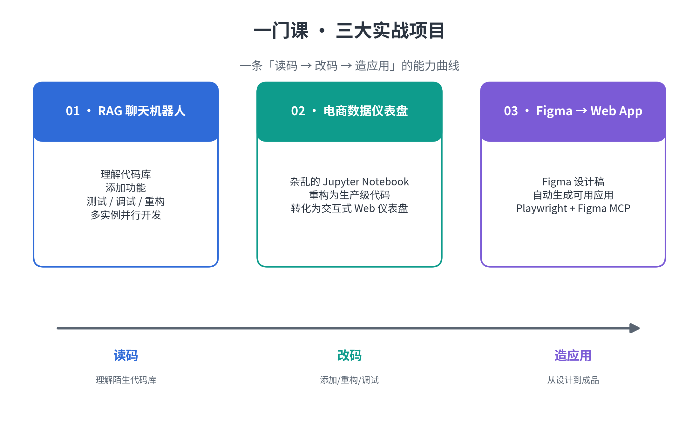
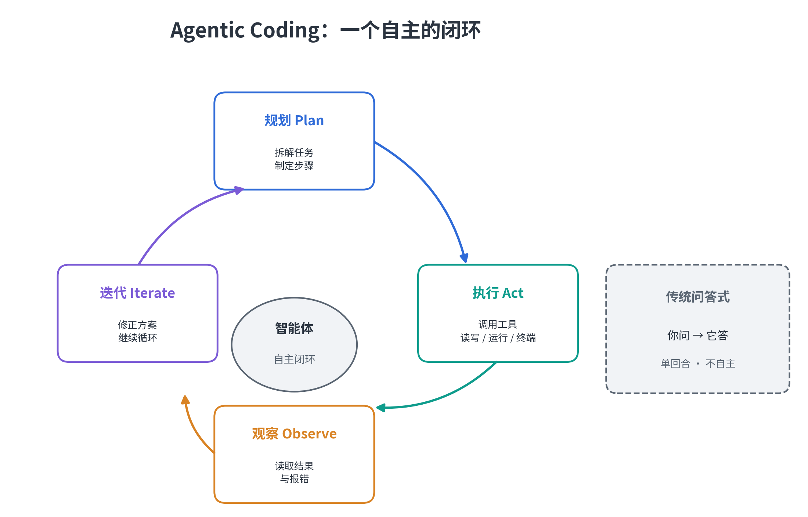
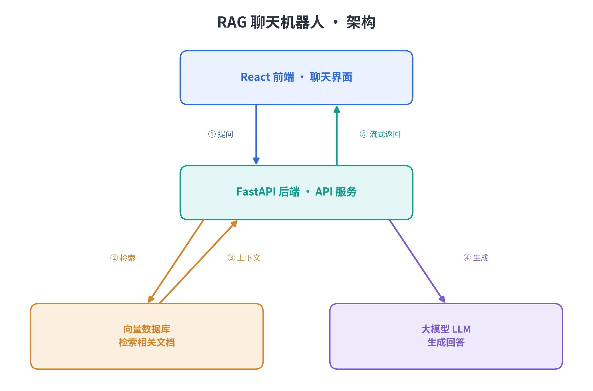
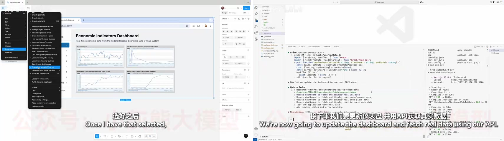
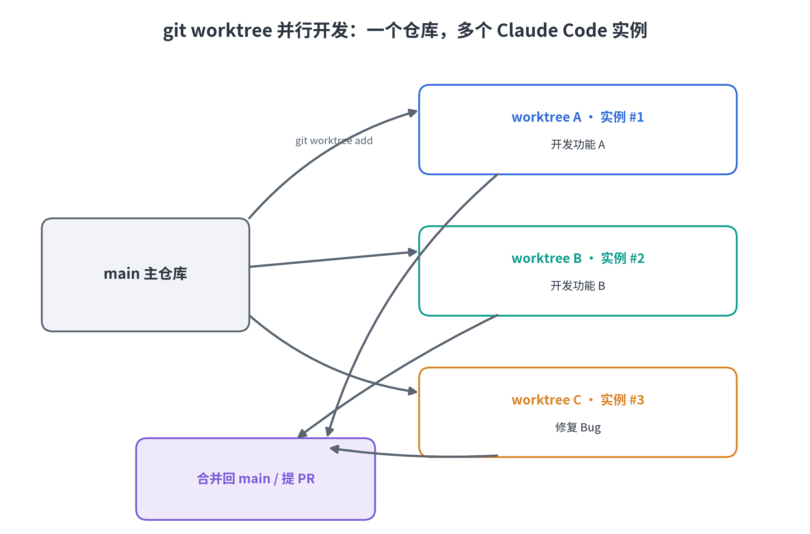

# Andrew Ng介绍的Claude Code高阶使用技巧

> 这是 DeepLearning.AI 免费短课《Claude Code: A Highly Agentic Coding Assistant》的学习笔记，吴恩达和 Anthropic 的 Elie Schoppik 主讲，全长 1 小时 50 分钟，讲怎么把 Claude Code 当个靠谱的 AI 助理来用。

这篇文章不是逐帧复述，我只挑自己觉得最值的那几个技巧展开，先说清楚底层那个核心概念，再一个个拆开，配上命令和我自己的用法判断。

---

## 一、课程总揽

整门课下来，我最想搬回自己工作流的是这几样：

- **`CLAUDE.md`**：让 AI 别再每次会话都失忆
- **thinking mode + Plan Mode**：先想清楚再动手
- **subagents**：一句话派几个子智能体并行头脑风暴
- **hooks**：在工具调用前后自动跑脚本
- **git worktree**：一个仓库开几个工作区，几个 AI 同时干
- **MCP**：给 AI 接上浏览器、设计稿这些外部工具

课程是用三个实战项目把它们串起来的，难度从「读代码」一路拉到「造 App」：



- **RAG 聊天机器人**（第 2–6 课）：看懂代码库 → 加功能 → 测试/调试/重构 → 多实例并行开发
- **电商数据仪表盘**（第 7 课）：把一份乱七八糟的 Jupyter Notebook 重构成能上线的 Web 工具
- **Figma 设计稿 → Web App**（第 8 课）：用 MCP 把设计稿直接变成能用的应用

下面先花一节讲清楚贯穿所有技巧的那个核心概念，再逐个拆解。

---

## 二、核心概念：Agentic Coding，一个自主的闭环

很多人刚上手 Claude Code，会当它是个「更强的 Copilot」：你说一句，它补一段。但这恰恰是这门课反复纠正的最大误解。

课程真正想讲的词是 **Agentic Coding（智能体编程）**。它和传统问答式 AI 的区别，就看能不能自己跑起来下面这个循环：



- **规划（Plan）**：把大任务拆成能一步步执行的清单
- **执行（Act）**：自己调工具，读写文件、跑代码、敲终端命令
- **观察（Observe）**：看结果、看报错、看测试输出
- **迭代（Iterate）**：根据反馈改方案，接着循环，直到搞定

传统的问答是线性的：你问 → 它答 → 你自己判断下一步。Agentic Coding 是闭环的：你只给目标，它自己把「规划-执行-观察-迭代」跑完，能自己干几分钟甚至更久。

说白了，这是从「AI 补全代码」到「AI 主导开发」的一次转变。理解这一点之后，`CLAUDE.md`、subagents、hooks、git worktree、MCP 这些技巧就不再是零散的高级功能，全是为了让这个循环跑得更稳、更快、边界更宽而准备的。记住这个框架，比背任何一条命令都值。

---

## 三、三大项目：一条能力曲线

### 项目一：RAG 聊天机器人（第 2–6 课，全课最重头）

技术栈是 FastAPI 后端 + React 前端 + 向量数据库 + 实时流式响应，架构长这样：



课程拿它演示了四个动作，一个比一个进阶：

1. **看懂代码库**：拿到陌生项目，第一件事不是埋头看代码，而是直接问 Claude，让它梳理架构、数据流、关键模块和依赖，甚至让它画架构图。配合 `@` 提文件、把截图贴进去当上下文，比人肉翻代码快一个量级。
2. **加功能**：从给引用来源加个超链接这种小事，到新加一个搜索工具。关键是先规划后执行：复杂任务先让它出计划，你点头了再动手，成功率会高不少。
3. **测试 / 调试 / 重构**：先让它写测试用例定位 bug，分析失败原因、给修复方案；再把只支持单次工具调用的代码重构成支持多轮连续调用。
4. **并行开发**：用 `git worktree` 起几个工作区，同时跑几个 Claude Code 实例，各自干各自的，最后合并。

这段最值的不是某个具体技巧，是那套「提问 → 规划 → 执行 → 验证」的做事方式。

### 项目二：Jupyter Notebook → 电商仪表盘（第 7 课）

做数据的人应该都懂这种痛：`EDA.ipynb` 写起来飞快，可一旦要变成能给别人用的东西，就卡住了。这节课演示的是，让 Claude 把一份乱糟糟的 notebook 一步步重构成结构清楚、能复用的代码，再转成交互式 Web 仪表盘，带可视化、性能指标、导出功能。

我反而觉得这是 AI 编程最实在的生产力：它不只会写新代码，更会把你那份烂代码给盘活。

### 项目三：Figma 设计稿 → Web App（第 8 课）

这节课是 MCP（Model Context Protocol）的专场。接个 **Playwright MCP**，Claude 就能自己开浏览器、截图、对着图改进 UI；接个 **Figma MCP**，就能把设计稿直接导进来，自动生成能用的应用。



看到这就明白了，Claude Code 的能力边界不是出厂写死的，是靠 MCP 动态扩出来的。这也是它跟传统 IDE 插件最不一样的地方。

---

## 四、核心技巧逐个拆

### 4.1 `CLAUDE.md`：让 AI 记住你的项目

Claude Code 每次在项目里启动，都会自动去读根目录下一个叫 `CLAUDE.md` 的文件。这文件就是写给 AI 看的项目说明书：架构长什么样、代码有哪些约定、哪些坑别踩，全写进去。AI 一进来就懂这个项目，不用你每次都重新介绍一遍。

它是分层加载的。从上到下依次是：企业策略（IT 统一配的，管所有人）、用户记忆（`~/.claude/CLAUDE.md`，只管你自己）、项目记忆（`./CLAUDE.md`，随代码提交、团队共享）。Claude 会从当前目录一路向上找，越具体的配置越优先，会覆盖或补充上面的。有了这一层，AI 就不用每次换会话都失忆了。

三个命令记住就够用：

- `/init`：让 Claude 扫一遍代码库，自动生成一份初始 `CLAUDE.md`，包含架构、依赖、编码风格。接手新项目，先跑这一条。
- `# 指令`：对话里随手加一条记忆，Claude 会问你存到项目、本地还是用户文件里，然后自己写进去。
- `/memory`：直接在编辑器里打开 `CLAUDE.md` 改。

课程里生成的那份 `CLAUDE.md` 是个好范本，就三段：**Development Commands**（怎么跑起来：`uv run uvicorn app:app --reload`、依赖管理、代码检查脚本）、**Architecture Overview**（各模块干嘛的、数据流、关键配置参数）、**Development Notes**（开发期注意点）。不管新人还是新开的 AI 会话，拿它几分钟就能上手。

用法上有两点我觉得实用：

- 用 `#` 专门纠正 AI 反复犯的错。课程是 `uv` 项目，AI 老想用 pip，就加一句 `# always use uv to run python files`，一次写死。
- 分清楚「个人偏好」和「团队约定」。像「别自动启动服务器」这种个人习惯，别提交进项目 `CLAUDE.md` 去烦别人。现在官方建议用 `@import`（比如 `@~/.claude/my-instructions.md`）把私人指令接进来，旧的 `CLAUDE.local.md` 已经废了。

说到底，`CLAUDE.md` 是 Claude Code 和「更聪明的补全」拉开差距的第一样东西。它把一次性对话，变成了能存进 git、能复用的一份资产。

### 4.2 先规划后执行：thinking mode 与 Plan Mode

用 AI 编程翻车，十有八九是同一个原因：任务描述太模糊，它就跑去改不该改的文件。课程给的办法是「先想清楚、再动手」，分两层。

第一层是 **thinking mode（深度思考）**。提示词里加上 `think`、`think hard`、`think harder`、`ultrathink`，逐级给 Claude 更多「思考预算」，让它动手前多花点 token 把方案想透。调试那一课，整段提示词结尾就一个词：`Think.`

第二层是 **Plan Mode（规划模式）**。`Shift+Tab` 切换，按一次是自动接受后续编辑，再按一次进只读规划。Claude 先给出一份详细行动计划，不碰任何文件，你批准了它才动手。因为只读，所以安全；而且想得久，代码通常也更好。

这俩加一块，就是 Anthropic 官方推荐工作流里的第一步「先设计后编码」。复杂任务先出计划、你确认，成功率明显更高。

不过有个坑，对用中文的人尤其致命：纯中文提示可能不触发 extended thinking。我实测下来，`ultrathink 做一个微信` 这种中英混输有效，`深度思考如何做一个微信` 这种就未必。所以记着，`ultrathink`/`think` 这类关键字写英文，剩下的中文无所谓。

反过来也得提醒一句：别把规划当仪式。AI 明显已经知道怎么干了，就让它直接写，更快也更省 token。规划是留给复杂、不确定、风险高的任务的，不是每句话都值得按一下 `Shift+Tab`。

### 4.3 subagents：一条指令，并行头脑风暴

Claude Code 自己能当工程师，subagents 就是它能随时招来的临时下属。它内置了 Task 工具，能派几个子智能体出去，每个都有自己的上下文窗口和工具集，互不干扰。你也可以在 `.claude/agents/` 放个 Markdown，自定义专属子智能体，用 `/agents` 管理。

课程里最漂亮的用法，是一句话同时派两个子智能体去「头脑风暴」一个重构方案。原话是：

> Use two parallel subagents to brainstorm possible plans. Do not implement any code.

精髓就在那句「让 AI 当技术经理，别亲自上阵」。两个子智能体各自独立读完代码库，交回来两份方案：一份迭代式小改，改动小、风险低；一份彻底重构，结构更干净、改动大。你挑一个，再让 Claude 进 Plan Mode 细化、批准、补测试。

这句完全可以抽成自己的 slash command，没事背一句 `Use N parallel subagents to brainstorm possible plans`。习惯了「AI 直接甩答案」的人，试过这步「先并行想、再选路」就知道，方案质量比多调几次模型强得多。

subagents 把 Claude Code 从一个聪明人变成了一个能开会的团队。这是它 agentic 属性最直白的地方。

### 4.4 hooks：让工程规范变成硬约束

`CLAUDE.md` 是规则，但规则靠 AI 自觉执行。hooks 是机制，在 Claude Code 生命周期的关键节点自动跑你指定的 shell 命令，把工程规范从「建议」变成「硬约束」。

常见的事件有这么几个：`PreToolUse`（工具调用前）、`PostToolUse`（调用后）、`UserPromptSubmit`（提交提示词时）、`BeforeSubagentResponse`（子智能体返回前）。用 `/hooks` 打开编辑器，配置写进 `.claude/settings.local.json` 的 `"hooks"` 字段。课程里给的最小示例，是在 `Read`/`Grep` 之后让 macOS 念一句「All done!」：

```json
{
  "hooks": {
    "PostToolUse": [
      {
        "matcher": { "tool_name": { "$in": ["Read", "Grep"] } },
        "command": "say 'All done!'"
      }
    ]
  }
}
```

会写这个，就能写真正有用的：

- `PostToolUse` 匹配 `Write`/`Edit` → 每次改完代码自动跑单测；
- `PreToolUse` 匹配 `Bash(git: commit)` → 提交前先过 lint/format；
- `PostToolUse` 匹配 `npm install` → 装完依赖自动 `npm audit`；
- `PreToolUse` 直接拦下对 `.env`、锁文件的改动。

它跟 GitHub 集成是一对：GitHub 管宏观流程的自动化（PR 审查、issue 派活），hooks 管微观执行（每一次工具调用前后）。等于把 CI 那套「提交即检查」的纪律，下沉到了 AI 的每次操作里。

注：hooks 事件名迭代很快，上面这几个是当下常见的，具体以官方 `/hooks` 文档为准。

### 4.5 git worktree：一个仓库，多个 AI 并行

单个 AI 再快也有上限。课程里最狠的一招，是用 `git worktree` 把一个仓库拆成几个并行工作区，每个工作区开一个 Claude Code 会话，各干各的：

```bash
mkdir .trees
git worktree add .trees/ui_feature
git worktree add .trees/testing_feature
git worktree add .trees/quality_feature
```



每个 worktree 共享同一个 `.git`，但文件是独立副本。你在每个目录里开一个 Claude Code，分别扔给它不同的功能，干完了回主终端，让 Claude 合并 `.trees` 里的所有分支，有冲突它自己解。课程里 `testing_feature` 和 `quality_feature` 都动了 `pyproject.toml`，合并时 Claude 能认出冲突标记，把 pytest 和 black 两套配置合成一份。

不过这不是白嫖的。worktree 让 Claude 跑在非当前目录，会破坏 `@` 的文件自动补全，还额外增加合并维护成本。所以它更适合团队分工，每个人（或每个 AI 实例）待在自己工作区里互不干扰，由负责人统一决定合并。个人为了炫技开一堆分支，纯属给自己找事。

这一步真正该学的不是 worktree 命令本身，是「把 AI 当可以编排的并行资源」这个习惯。哪天你习惯了一个仓库同时跑几个 Claude 干活，效率的天花板就被捅破了。

### 4.6 MCP：给 AI 接上外部工具

前面几个技巧都在「代码」里打转。MCP（Model Context Protocol）不一样，它把 Claude Code 的手脚伸到了外面。通过这套标准协议接外部工具，Claude 就能读设计稿、操作浏览器，等于多了一双眼睛一双手。

课程用了两个 MCP 服务器，配置各一行：

```bash
# 浏览器自动化（导航、点击、执行 JS、截图）
claude mcp add playwright npx @playwright/mcp@latest

# Figma 设计稿（官方 Dev Mode，走本地 HTTP）
claude mcp add --transport http figma-dev-mode-mcp-server http://127.0.0.1:3845/mcp
```

接完用 `/mcp` 看连接状态、它暴露了哪些工具。第 8 课的「设计稿直出 App」是真秀：在 Figma 里复制图层链接，让 Claude 用 Figma MCP 读稿子，用 Next.js + Recharts 写出组件化页面，再用 Playwright 打开 `localhost:3000` 自己截图、跟稿子对比迭代。全程没有一次「你帮我看看截图对不对」的人工来回，它自己长眼睛看自己写的东西。最后一句「用 FRED 的真实数据填充图表」，它还会主动停下来找你要 API key。

权限上有个小坑：默认每次用 Playwright 截图，Claude 都会停下来问你批不批。想省事就去 `/permissions` 加一条允许规则，完整工具名是 `mcp__playwright__browser_take_screenshot`（`/mcp` 里能查到）。

到这儿就能看清 Claude Code 跟传统 IDE 插件的根本差别：它的能力边界不是出厂写死的，是靠 MCP 动态扩出来的。接数据库、接公司内部系统、接任何有 MCP 的东西，都是同一套协议。

---

## 五、其他值得学的技巧

除了上面几个主角，课程里还有些随手能用的东西，挑重要的说：

- **`@` 提及与截图**：`@路径` 把文件或文件夹喂给 Claude，它是按需读取的，不像某些工具一上来就急切内联、白烧上下文。截图直接 `Ctrl+V` 粘贴，注意 Mac 上是 Ctrl，不是 Cmd+V。前端改样式时，「截图 + 这行字看不清」比什么文字描述都准。路径带空格得加引号，带括号会打断补全。
- **自定义 slash 命令**：在 `.claude/commands/` 放个 Markdown，文件名就是命令名，`$ARGUMENTS` 接住你输入的参数。课程里的 `implement-feature.md` 就是个「只做前端、做完写 changelog、不用问权限」的模板。它跟 `CLAUDE.md` 的分工是：后者每次会话自动加载，管高频背景规则；前者显式调用，管一次性工作流。
- **GitHub 集成**：`/install-github-app` 一键生成两个 workflow，`code-review.yml`（新 PR 自动审查）和 `claude.yml`（在 Issue 里 `@claude` 就能自动修 bug 并开 PR）。最好玩的是「Claude 审查自己刚写的代码」。配的时候 GitHub PAT token 权限别抠，直接勾全，否则中途各种报错（至少得有 action、content、PR 的读写权）。
- **TDD 调试**：遇到「查询失败」这种 bug，先让 Claude 写一个能稳定复现的测试，它一开始必失败；再让它跑测试定位根因，课程里真凶是 `MAX_RESULTS = 0`。修完跑绿，这份测试就成了永久「免疫系统」。
- **`/clear` vs `/compact`**：上下文太长时，`/clear` 是全部清空，AI 会连刚才说过的话一起忘；`/compact` 是压缩成摘要保下来，还能带指令指定留什么，比如 `/compact 只保留代码示例和 API 用法`。想续命就用后者。
- **终端与无头**：`claude -c` 续上一个会话、`claude -r` 从历史里挑、`claude -p "提示词"` 无头跑单任务。对话里 `!命令` 直接执行 bash，`ESC` 打断，`ESC ESC` 回退到更早的对话节点。
- **结构化提示词**：一个万能五段式，Context（现状）/ Goal（目标）/ Example（示例）/ Constraints（约束）/ Methodology（方法）。课程里那些高质量提示词，拆开都是这个骨架。

---

## 附录：命令速查与 Prompt 模板

正文里把命令都散着提过了，这里汇一张表方便翻。另附四个课程里的高质量提示词模板，改个名字就能照抄。

### 命令速查表

| 分类 | 命令 | 作用 |
| --- | --- | --- |
| 会话 | `claude` / `claude -c` / `claude -r` / `claude -p "…"` | 新会话 / 续上次 / 挑历史 / 无头跑单任务 |
| 会话 | `/clear` / `/compact` | 清空上下文 / 压缩成摘要（`/compact` 可带指令指定留什么） |
| 记忆 | `/init` / `# 指令` / `/memory` | 扫库生成记忆 / 随手加一条 / 打开编辑 |
| 扩展 | `/mcp` / `/agents` / `/hooks` | 接外部工具 / 管子智能体 / 配 hooks |
| 集成 | `/install-github-app` | 接 GitHub 自动审查与派活 |
| 权限 | `/permissions` | 管工具权限、加白名单 |
| 其他 | `/model` / `/config` / `/doctor` / `/cost` | 切模型 / 改配置 / 环境体检 / 看 token 成本 |

`--dangerously-skip-permissions` 能跳过所有权限提示，只在非交互脚本里用，日常别碰。

### 四个能直接照抄的 Prompt

**① 测试驱动调试（第 4 课）**：先让它写一个「现在必挂」的复现测试，再修到绿，等于顺手给项目加了道回归防线。结尾那个 `Think.` 别删：

```
The RAG chatbot returns 'query failed'. I need you to:
1. Write tests for the core components in @backend/search_tools.py, @backend/ai_generator.py, and the RAG system itself.
2. Save the tests in a `tests/` directory within @backend.
3. Run these tests to identify the failing component.
4. Propose a fix based on the test results.
Think.
```

**② 关注点分离重构（第 7 课）**：把混乱的单体脚本按「结构、代码质量、可配置」三个要求，搬进干净模块：

```
Refactor the @EDA.ipynb for e-commerce data analysis.

**Requirements:**
1.  **Structure:** Organize into logical sections (Intro, Loading, Prep, Metrics, Summary) with proper markdown documentation.
2.  **Code Quality:** Create reusable functions with docstrings and move core logic into separate Python modules: `business_metrics.py` and `data_loader.py`.
3.  **Configurability:** Refactor the analysis to be configurable by date range.

**Deliverables:** A refactored notebook, two Python modules, and a `requirements.txt`.
```

**③ 「布局即 Prompt」的 UI 生成（第 7 课）**：用自然语言把线框图和组件位置写清楚，AI 照着长，比「做个好看的仪表盘」这种空话靠谱：

```
Convert `@EDA_Refactored.ipynb` into a professional Streamlit dashboard with this exact layout:

## Layout Structure
- **Header**: Title + date range filter (applies globally)
- **KPI Row**: 4 cards (Total Revenue, Monthly Growth, Average Order Value, Total Orders)
- **Charts Grid**: 2x2 layout (Revenue trend, Top categories, Revenue by state, etc.)

## Key Requirements
- Use Plotly for all charts
- Filter update charts correctly
- Professional styling with trend arrows/colors
```

**④ 设计稿直出 App（第 8 课）**：先用 MCP 复刻视觉，再让它自己查 API 灌真数据，设计、实现、验证、数据绑定一次委托：

```
Using the figma mockup link [paste link], use the figma dev MCP server to build the UI in this Next.js application. Use the recharts library for charts. Then, use the playwright MCP server to verify the implementation visually against the mockup.
```

等它出第一版，再补一句让它填真数据：

```
Populate these charts with real-world data from the FRED API.
```

### 学完怎么往下走

- **个人提效**：吃透 `@` 引用、结构化 Prompt、`#` 记忆，再把 TDD 和自定义 slash 命令用进日常。
- **团队协作**：项目级 `CLAUDE.md` 沉淀规范，上 Git Worktree 并行 + GitHub Actions 自动审查。
- **平台 / DevOps**：用 hooks 做质量门禁，接 MCP 打通监控、工单，再研究 Bedrock / Vertex AI 这类企业部署。

---

## 参考资源

- 官方课程：<https://www.deeplearning.ai/short-courses/claude-code-a-highly-agentic-coding-assistant/>
- B 站视频（包含代码）：<https://www.bilibili.com/video/BV1t665BXEJR/>
- 中文学习笔记（GitHub）：<https://github.com/MarkShawn2020/DeepLearning.ai-Courses-ClaudeCode>（其中「吴恩达 Claude Code 笔记精华版.md」是命令速查与提示词模板的精华汇总）

---
